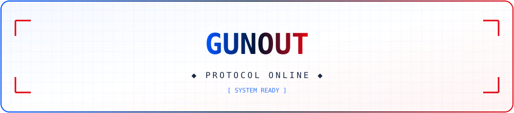
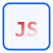
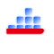
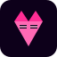

  

<h1 align="center">GUNOUT</h1>

  <strong>Développeur & Automatisation</strong> 
  Python · Web · Data · Veille

  
  
  

  

---

## À propos

Développeur orienté **automatisation et livraison rapide**. Je conçois des outils qui suppriment les tâches répétitives, connectent des services entre eux et rendent les données exploitables.

- 🔭 Actuellement : systèmes d'automatisation Python & intégrations web
- 🧠 Centres d'intérêt : data pipelines, veille technologique, scripting système
- ⚡ Philosophie : *build small, ship fast, automate the rest*
- 📍 Basé à La Réunion · 🌐 Disponible en remote

---

## Stack

<table>
  <tr>
    <td align="center" width="96">
       
      <b>Python</b>
    </td>
    <td align="center" width="96">
       
      <b>JavaScript</b>
    </td>
    <td align="center" width="96">
       
      <b>HTML5</b>
    </td>
    <td align="center" width="96">
       
      <b>CSS3</b>
    </td>
    <td align="center" width="96">
       
      <b>Docker</b>
    </td>
    <td align="center" width="96">
       
      <b>BackBox</b>
    </td>
  </tr>
</table>

**Langages** · Python, JavaScript, Bash, SQL
**Web** · FastAPI, Node.js, HTML/CSS
**Data** · Pandas, Plotly, scraping & parsing
**Infra** · Docker, Linux, CI/CD, automatisation système
**Sécurité** · BackBox, audit, scripting défensif

---

## Projets sélectionnés

<table>
  <tr>
    <td width="50%" valign="top">
      <h3>🤖 <a href="https://github.com/GUNOUT/REPO_1">REPO_1</a></h3>
      
Outil d'automatisation Python pour <em>[cas d'usage concret]</em>.

      

        
        
        
      

    </td>
    <td width="50%" valign="top">
      <h3>📡 <a href="https://github.com/GUNOUT/REPO_2">REPO_2</a></h3>
      
Service web / API pour <em>[problème résolu]</em>.

      

        
        
      

    </td>
  </tr>
  <tr>
    <td width="50%" valign="top">
      <h3>🧠 <a href="https://github.com/GUNOUT/REPO_3">REPO_3</a></h3>
      
Pipeline data / visualisation pour <em>[type de données]</em>.

      

        
        
      

    </td>
    <td width="50%" valign="top">
      <h3>🛡️ <a href="https://github.com/GUNOUT/REPO_4">REPO_4</a></h3>
      
Scripts d'audit et d'automatisation sécurité.

      

        
        
      

    </td>
  </tr>
</table>

---

## Statistiques

  

---

## Contact

  
  
  

  

