<!-- ============================================================ -->
<!--  GUNOUT — FUTURISTIC NEON BLUE WHITE RED PROFILE             -->
<!-- ============================================================ -->

  

  

<!-- CARTE MATRIX UNIQUEMENT -->

  

  

  

  
    

  

<h2 align="center">⚡ <code>whoami</code></h2>

  <samp>
    🐍 Python & Automation — Scrapers, monitors, dashboards 
    🌐 Web Development — HTML, JavaScript, data visualization 
    🐚 Shell & Scripting — Task automation, processing pipelines 
    📊 Veille & Data — News, markets, institutions, space 
    🚀 Rapid Shipping — 47 repos in October 2026 
    🔭 Interests — Aerospace, maritime, real estate, health, public policy
  </samp>

  

<h2 align="center">🛠️ <code>tech_stack</code></h2>

  
  
  
  
  
  

  

<h2 align="center">🚀 <code>recent_projects</code></h2>

  <i>Une sélection de mes derniers dépôts, par domaine</i>

<h3 align="center">🛰️ Aerospace & Space</h3>

  
  
  
  

<h3 align="center">📊 Monitors & Veille</h3>

  
  
  
  

<h3 align="center">💻 Tools & Automation</h3>

  
  
  

  

<h2 align="center">📈 <code>github_stats</code></h2>

  

  
  
  

  

    

  <picture>
    <source media="(prefers-color-scheme: dark)" srcset="./assets/images/footer_neon.svg">
    <source media="(prefers-color-scheme: light)" srcset="./assets/images/footer_neon.svg">
    
  </picture>

  

